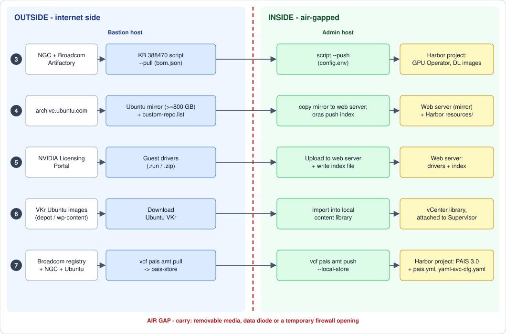

# Private AI Foundation — Dark-Site Build Walkthrough

The step-by-step companion to [`33-private-ai-foundation.md`](33-private-ai-foundation.md).
Guide 33 says **what** has to be staged and **why**; this page is the **order of
work and the commands** for a disconnected (air-gapped) build, from the bastion
host to the point where the Private AI Foundation Quickstart can run.

> **Evidence level:** commands and values are taken from the
> [*VMware Private AI Foundation with NVIDIA 9.1*][paif-pdf] PDF and
> [KB 388470][kb388470] (both read 2026-10-30). **Not run on a build in this
> repo yet.** Where a step is general practice rather than Broadcom's text, it
> says so.

Read [`33` §4](33-private-ai-foundation.md#4-dark-site-staging-infrastructure-and-artifacts)
first for the artifact list and the capacity planning. Everything below assumes
the GPU workload domain and Supervisor exist
([`32-gpu-hosts.md`](32-gpu-hosts.md), [`33` §3](33-private-ai-foundation.md#3-the-workload-domain-hosts-and-vm-classes)).

---

## The flow

[](../web/public/diagrams/paif-dark-site-flow.svg)

*Click the picture to open it full size.*

Read it left to right: **source → bastion (pull) → carry across the air gap →
admin host (push) → destination**. The red badge on each arrow is the carry (1
tooling, 2 content, 3 Private AI Services); the schedule is in
[the three carries](#the-three-carries-and-when-each-happens). Every lane
repeats on each refresh. The numbers are the phases below.

## Where each phase runs, and what crosses the gap

**Outside** is the bastion side (internet). **Inside** is the air-gapped side
(admin host, Harbor, web servers, vCenter, Supervisor). Only the admin host
reaches the inside, and nothing reaches the inside from the internet, so
everything the inside needs has to be **carried across** after the bastion has
pulled it.

| Phase | What you end up with | Runs on | Crosses the gap? |
| --- | --- | --- | --- |
| [0. Prepare](#0-prepare-what-you-need-before-you-start) | Accounts, tokens, a capacity plan | Outside | No |
| [1. Hosts](#1-bastion-and-admin-hosts) | Bastion and admin host with their tooling | Bastion: outside. Admin: inside | **Yes, Carry 1:** the offline CLI + plug-in bundle and the scripts |
| [2. Harbor](#2-harbor-the-platform-registry) | Platform Harbor, a project, a robot account | Inside (Harbor admin) | No |
| [3. Mirror containers](#3-mirror-the-gpu-operator-and-dl-workload-images) | GPU Operator + DL workload images in Harbor | **Pull:** bastion. **Push:** admin | **Yes, Carry 2:** the resources directory (and `.tar` files) |
| [4. Ubuntu mirror](#4-ubuntu-package-mirror-and-index-file) | Package mirror + `custom-repo.list` in Harbor | **Build mirror:** bastion. **Serve + `oras push`:** inside | **Yes, Carry 2:** the mirror tree (the largest item) |
| [5. Driver server](#5-vgpu-and-data-center-drivers) | Guest drivers + index file on a web server | **Download:** bastion. **Upload, index:** inside | **Yes, Carry 2:** the driver files (the index is written inside) |
| [6. VKr library](#6-vkr-content-library-ubuntu) | Ubuntu VKr images in a local content library | **Download:** bastion. **Import:** vCenter, inside | **Yes, Carry 2:** the image files (depot route: with the depot transfer, [`09`](09-binary-depot.md)) |
| [7. Private AI Services](#7-private-ai-services-30-artifacts) | PAIS 3.0 package, engines, GPU Operator in Harbor | **Pull:** bastion. **Push:** admin | **Yes, Carry 3:** `pais-store` |
| [8. Verify](#8-verify-before-the-quickstart) | A checklist that catches the common gaps | Inside | No |

### The three carries, and when each happens

| Carry | When | What goes across | Size |
| --- | --- | --- | --- |
| **1 — Tooling** | **First**, before any push. The admin host can download nothing, so without this it cannot even run `vcf pais` | Offline VCF CLI + plug-in bundle, the KB 388470 zip, `config.env` template, the YAML files | Small (hundreds of MB, measure yours) |
| **2 — Content** | After each pull finishes and its checksums are written. Phases 3 to 6 are independent: carry each when ready, do not wait for all | Resources directory / `.tar` files (3), Ubuntu mirror tree (4), driver files (5), VKr images and `.ova` (6) | **Large**: 180 GB+ for phase 3, ≥ 800 GB for the Ubuntu mirror |
| **3 — Private AI Services** | After `vcf pais amt pull` finishes. Needs Carry 1 (the `pais` plug-in) already inside | The `pais-store` directory and the Ubuntu index content | About 40 GB ([PAIF 9.1][paif-pdf]) |

Nothing goes **out** of the inside: the admin host never needs to send anything
back. Files created inside (`index.txt`, the generated `pais.yml` and
`yaml-svc-cfg.yaml`) stay there. **Every refresh repeats Carry 2 or 3** for the
part that changed ([Refreshing](#refreshing)). For how to keep the volume down,
see [`33` §4.2a](33-private-ai-foundation.md#42a-plan-the-outside-staging-first--it-is-the-hard-part).

Phases 3, 4, 5, 6 and 7 are independent once phases 1 and 2 are done; run them
in parallel if the transfer path allows it.

---

## 0. Prepare: what you need before you start

> **Where:** outside. **Gap:** nothing crosses.

Collect these **on the bastion side** before the window opens. A missing token
costs more time than any install step.

| Item | Where from | Used in |
| --- | --- | --- |
| **Broadcom Support Portal login** | [support.broadcom.com](https://support.broadcom.com) | Downloads, KB 388470 script |
| **Registry token** | Support Portal → *My Downloads* → *Registry Tokens* → *Generate Token* | `docker login` to `pais-docker.packages.broadcom.com` and `dlvm.packages.broadcom.com` |
| **NGC API key** with the **NVAIE entitlement** | NVIDIA NGC ([API keys][ngc-keys]) | Pulling from `nvcr.io` and `helm.ngc.nvidia.com` |
| **NVIDIA Licensing Portal access** | NVIDIA | Guest drivers; the DLS appliance ([`33` §2](33-private-ai-foundation.md#2-nvidia-licensing-and-access)) |
| **Harbor admin credentials** | Whoever runs the platform Harbor | Phases 2, 3, 7 |
| **A written list of what you will stage** | You | Capacity planning, [`33` §4.2a](33-private-ai-foundation.md#42a-plan-the-outside-staging-first--it-is-the-hard-part) |

Decide now which compute models you will offer. The GPU Operator comes in two
variants, **vGPU (`nvaie`)** and **GPU passthrough (`oss`)**
([PAIF 9.1][paif-pdf]); pulling only the one you use saves space.

---

## 1. Bastion and admin hosts

> **Where:** you build both hosts; the bastion sits outside, the admin host inside. **Gap:** **Carry 1** crosses here: the offline CLI and plug-in bundle, because the admin host cannot download them.

Roles and the single-machine shortcut are in [`33` §4.1](33-private-ai-foundation.md#41-bastion-and-admin-hosts).
Build both from the **same Ubuntu image** ([PAIF 9.1][paif-pdf]); if you already
built them for the Supervisor
([`20` §4.1](20-supervisor-image-registry.md#41-two-hosts-and-the-tooling)),
reuse them and only add what is missing.

### What the two hosts are for

- The **bastion** is the only machine that talks to the internet. It pulls and
  packages everything and serves nothing. Broadcom's wording: *"a VM, usually
  running Linux, that is connected to the Internet or has access to download
  packages"* ([PAIF 9.1][paif-pdf]).
- The **admin host** is the only machine that talks to the inside: Harbor, the
  web servers, vCenter, the Supervisor. It pushes what the bastion pulled.
- Splitting them means the isolated side never needs an internet route. One
  machine can do both only where it has both network paths, for example a DMZ
  server with temporary access into the isolated network; with two, the files
  cross the gap by hand ([`33` §4.1](33-private-ai-foundation.md#41-bastion-and-admin-hosts)).

### Using your own workstation as the bastion

The bastion is a role, not a particular server, so a workstation or laptop can
fill it for the download side: William Lam does exactly that in his
[PAIS walkthrough][lam-amt]. Agree it with the customer first: some sites do not
allow outside equipment to carry files onto their network. The safe split is
that **your workstation is the bastion only**, and a **customer-owned admin
host** does the push after the files are carried in (and scanned, if their
policy says so).

**What the workstation needs**

| Need | Value | Source |
| --- | --- | --- |
| Operating system | **Ubuntu 22.04 or 24.04** for the mirroring script, so a Linux VM (or native Linux) on a Windows or macOS laptop. WSL2 should work for the bash tools but is **untested** here and not named by Broadcom | [KB 388470][kb388470] |
| CPU / RAM | 4 cores and 8 GB for the script (give the VM that, plus what the host needs) | [KB 388470][kb388470] |
| Disk | **180 GB free** with the default `bom.json`, **+100 GB** with `PACK_CONTAINER=true`; add the Ubuntu mirror (**≥ 800 GB**, [phase 4](#4-ubuntu-package-mirror-and-index-file)), the drivers, the `.ova`, the VKr images and any models. Use an external SSD for the staging area | [KB 388470][kb388470], [PAIF 9.1][paif-pdf] |
| Network | Internet access to the hosts in the [paths table](#1-bastion-and-admin-hosts) below, directly or through a proxy | [PAIF 9.1][paif-pdf] |
| Tools | Docker (**v27.5 or earlier**), `jq`, `helm`, the VCF Consumption CLI with the `pais` plug-in | [KB 388470][kb388470] |
| Accounts | The **customer's** Support Portal login and registry token, NGC key with NVAIE entitlement, NVIDIA Licensing Portal access (the entitlements are theirs, not yours) | [PAIF 9.1][paif-pdf] |

**What should be on it before you carry anything in**

| Item | Why |
| --- | --- |
| The KB 388470 zip for the target version, `bom.json` set to the release you run, `config.env` filled | Phase 3 |
| **Both** CLI downloads: the online install for the bastion **and** the offline CLI + plug-in bundle for the admin host | The admin host cannot fetch plug-ins ([phase 1](#1-bastion-and-admin-hosts)) |
| `pais-3.0.0-external.yaml`, the pulled `pais-store` | Phase 7 |
| The Ubuntu mirror tree and your `custom-repo.list` | Phase 4 |
| Guest drivers and the draft `index.txt` | Phase 5 |
| Ubuntu VKr images and the deep learning VM `.ova` | Phase 6 and the Quickstart |
| A **manifest**: file names, versions, SHA-256 checksums | Verified on the admin host before any push |
| The written BOM / version list | Refresh diffing ([Refreshing](#refreshing)) |

**When you are done, clean the workstation** (general practice): delete
`config.env`, run `docker logout` for each registry and remove the stored
credentials, clear the shell history, and have the customer **revoke or rotate**
the registry token and NGC key if they were created for this job. Keep nothing
customer-specific on the laptop beyond what your agreement allows.

**Minimum for the mirroring script** ([KB 388470][kb388470]): Ubuntu 22.04 or
24.04, 4 cores, 8 GB RAM, and **at least 180 GB free disk** with the default
`bom.json` (**+100 GB** if you set `PACK_CONTAINER=true`, see
[phase 3](#3-mirror-the-gpu-operator-and-dl-workload-images)).

| Tool | Bastion | Admin | Notes |
| --- | --- | --- | --- |
| Docker | ✓ | ✓ | KB 388470: **v27.5 or earlier**. Non-root use: [post-install steps][docker-post] |
| `jq`, `helm` | ✓ | ✓ | On `PATH` |
| VCF Consumption CLI + `pais` plug-in | ✓ | ✓ | Install below |
| `kubectl` | | ✓ | Admin host talks to the Supervisor |
| `oras` | | ✓ | Pushes the Ubuntu index file ([phase 4](#4-ubuntu-package-mirror-and-index-file)) |

**Install the VCF Consumption CLI and the `pais` plug-in** (apt method from
[KB 388470][kb388470], which labels it *"VCF 9.0.x only"*; for 9.1, PAIF 9.1
installs the CLI from the vSphere Client, *Download and Install the VCF
Consumption CLI from the vSphere Client*):

```bash
sudo apt update && sudo apt install -y ca-certificates curl gpg
sudo mkdir -p /etc/apt/keyrings
curl -fsSL https://packages.broadcom.com/artifactory/api/security/keypair/PackagesKey/public \
  | sudo gpg --dearmor -o /etc/apt/keyrings/vcf-archive-keyring.gpg
echo "deb [signed-by=/etc/apt/keyrings/vcf-archive-keyring.gpg] https://packages.broadcom.com/artifactory/vcfcli-debian noble main" \
  | sudo tee /etc/apt/sources.list.d/vcf.list
sudo apt update && sudo apt install -y vcf-cli
vcf plugin search                     # shows which pais versions exist
vcf plugin install pais --version v3.0.0   # match the PAIS version you install (§7)
vcf plugin list                       # pais should show "installed"
```

**Inside the air gap (admin host), install the plug-ins from an offline bundle.**
The online route fails there: `vcf plugin install pais` ends in
`MANIFEST_UNKNOWN` because the CLI looks for plug-in metadata on
`projects.packages.broadcom.com` ([KB 451356][kb451356]). Broadcom documents an
offline method instead ([KB 415112][kb415112]; William Lam walks it through for
9.1.1 in his [PAIS AMT post][lam-amt]):

1. On the bastion, download from the Support Portal the **VCF Consumption CLI**
   and the **VCF Consumption CLI Plugins** bundle
   (`VCF-Consumption-CLI-PluginBundle-<OS>_<ARCH>-<release>.tar.gz`), matching
   your VCF version. Direct 9.0.0 URLs are in [KB 415112][kb415112] and Lam's
   [CLI download tip][lam-cli]; use the Support Portal for 9.1.x.
2. Carry both files to the admin host. Put the `vcf` binary on the `PATH`.
3. Clear the cached online metadata, extract the bundle, install from it:

   ```bash
   rm -rf ~/.local/vcf ~/.local/vcf-cli-telemetry
   mkdir -p ~/vcf-plugin-bundle
   tar -xvzf VCF-Consumption-CLI-PluginBundle-*.tar.gz -C ~/vcf-plugin-bundle/
   vcf plugin install all --local-source ~/vcf-plugin-bundle/
   vcf plugin list
   ```

   Use `vcf plugin install pais --local-source <bundle-root>` for just the
   `pais` plug-in. The first-start error about the online discovery URL and a
   timeout on the `telemetry` plug-in are **expected** and harmless
   ([KB 415112][kb415112]).

The same bundle route works on the bastion if it also lacks direct access.

**Prove the network paths before the window.** Each hop below is a firewall
request or a transfer route; list them in your change ticket.

| From | To | Why | Source |
| --- | --- | --- | --- |
| Bastion | `pais-docker.packages.broadcom.com`, `packages.broadcom.com` | Private AI Services package and inference engines | [PAIF 9.1][paif-pdf] |
| Bastion | `helm.ngc.nvidia.com`, `nvcr.io` | GPU Operator chart, NVIDIA images | [PAIF 9.1][paif-pdf] |
| Bastion | `archive.ubuntu.com` | Ubuntu package mirror | [PAIF 9.1][paif-pdf] |
| Bastion | `dlvm.packages.broadcom.com` | `deep-learning-container` image (9.1.1) | [KB 388470][kb388470] |
| Bastion | `support.broadcom.com`, `wp-content.vmware.com` | Downloads (YAML, CLI bundles, `.ova`), Ubuntu VKr images | [PAIF 9.1][paif-pdf] |
| Bastion | NVIDIA Licensing Portal | Guest drivers | [PAIF 9.1][paif-pdf] |
| Admin host | Harbor (443) | `docker login`, `oras push`, `amt push` | General practice |
| Admin host | Management vCenter, Supervisor API | Content library import, `kubectl`, registry settings | General practice |
| Supervisor / VKS nodes | Harbor, Ubuntu mirror web server | Pulling images, compiling the driver | General practice |
| Deep learning VMs | Driver web server | Fetching the guest driver | General practice |

If the bastion reaches the internet through a **proxy**, set `HTTP_PROXY`,
`HTTPS_PROXY`, `NO_PROXY` in the shell **and** give the Docker daemon a systemd
drop-in (`/etc/systemd/system/docker.service.d/proxy.conf`, then
`systemctl daemon-reload && systemctl restart docker`), exactly as
[KB 388470][kb388470] describes.

---

## 2. Harbor: the platform registry

> **Where:** inside, as the Harbor administrator. **Gap:** nothing crosses. Finish this before the first push in phase 3.

Which Harbor route applies to you is the table in
[`33` §7](33-private-ai-foundation.md#7-platform-harbor-registry). In short:

| Your situation | Do this |
| --- | --- |
| VCF 9.1 **with** VCF Automation | VCF Automation Provider Management → install the **Harbor service** (*Install Regional Harbor*). It pulls Supervisor Service packages from the software depot by itself. |
| 9.1.1 **without** VCF Automation | Deploy the Harbor Supervisor Service **from the software depot** (*Deploying VKS in Air-Gapped Environments*). |
| 9.1.0 **without** VCF Automation | Deploy Harbor + Contour as Supervisor Services from a **bootstrap Harbor**: the Carvel packages sit in the bootstrap registry and the manifest YAMLs are edited to point at it. Written up in the 9.0 docs ([Local Harbor registry][td-harbor]). |

Then, with Harbor running ([PAIF 9.1][paif-pdf]):

1. **Create a project** for the PAIF resources (the Harbor administrator does
   this; [phases 3](#3-mirror-the-gpu-operator-and-dl-workload-images) and
   [7](#7-private-ai-services-30-artifacts) push into it). Use separate projects
   for the DL/GPU Operator images and for Private AI Services if you want to
   keep their lifecycles apart (general practice).
2. **Size it.** The KB 388470 script project needs **at least 180 GB free**;
   Private AI Services needs **40 GB**; add the models you will serve.
3. **Create a robot account** that can pull from the model galleries (needed for
   Private AI Services endpoints).
4. **On 9.1.1:** create a **public** project for `deep-learning-container`
   (needed even when connected, see [`33` §8](33-private-ai-foundation.md#8-catalog-items-the-private-ai-foundation-quickstart)).
5. **Trust Harbor's CA** on the Supervisor / VKS side
   ([`20` §4.8](20-supervisor-image-registry.md#48-harbor-for-user-images-only-if-you-need-one)).

**In the Harbor UI** (general Harbor practice; the PAIF text only says *create a
project* and *create a robot account*):

1. *Projects → New Project*: name it (for example `paif`), set a **storage
   quota** above your total, access level **private**. Create a second project
   for Private AI Services if you split them, and on 9.1.1 the **public**
   project for `deep-learning-container`.
2. *Robot Accounts → New Robot Account* (system level, or per project): give it
   a name and an expiry, **pull** permission on the model-gallery project, and
   copy the secret when it is shown: Harbor does not show it again. Put the
   expiry in the team calendar; a lapsed robot account breaks model pulls.
3. Note the **Harbor FQDN** and whether its certificate chains to a CA the
   Supervisor and VKS nodes already trust. If not, that CA goes onto the
   Supervisor ([`20` §4.8](20-supervisor-image-registry.md#48-harbor-for-user-images-only-if-you-need-one))
   before anything can pull.

**Check:** from the admin host, `docker login <harbor-fqdn>` succeeds, and you
can push a small test image to the project.

---

## 3. Mirror the GPU Operator and DL workload images

> **Where:** **pull on the bastion (outside)**, **push on the admin host (inside)**. **Gap:** **Carry 2** crosses between steps 4 and 5: carry once the pull has finished and you have checksums.

This is the *resource mirroring utility* of the PAIF docs: a shell script from
[KB 388470][kb388470]. It mirrors **container images, Helm charts and model
profiles** for deep learning VMs and VKS clusters with GPU.

1. **[Outside] Download the zip that matches your VCF version** from the KB attachments
   (`vpaifn-airgap-res-mirror-9.1.x.zip` for 9.1). Unzip it. You get
   `vpaifn-airgap-res-mirror.sh`, `config.env` and BOM files.
2. **[Outside] Pick the release.** The default `bom.json` is the **latest release in the
   series** (for 9.1.x that is **9.1.1**). To mirror an older release, overwrite
   `bom.json` with the matching `bom-<release>.json`. Broadcom warns that
   resources in older BOMs may have been **removed from the source registry**,
   so pulls can fail.
3. **[Outside] Edit `config.env`:**

   | Variable | Value |
   | --- | --- |
   | `LOCAL_HARBOR_URI` | Harbor and project, e.g. `harbor.sfo.rainpole.io/paif-project` |
   | `LOCAL_HARBOR_USERNAME` / `LOCAL_HARBOR_PASSWORD` | Harbor credentials (default user `admin`) |
   | `NGC_API_KEY` | NGC key **with the NVAIE entitlement** |
   | `LOCAL_RESOURCES_DIR` | Disk path for the downloaded resources |
   | `PACK_CONTAINER` | `true` if pull and push run on **different machines**: each image is saved as a `.tar` you can carry across (needs **+100 GB**). Default `false`. |

4. **[Outside, bastion] Pull:**

   ```bash
   ./vpaifn-airgap-res-mirror.sh --pull
   ```

5. **[Across the gap, Carry 2] Carry across.** Copy the package directory, `config.env` and
   `LOCAL_RESOURCES_DIR` to the admin host (with `PACK_CONTAINER=true`, that
   includes the `.tar` files). Checksum before and after
   (`sha256sum`, general practice).
6. **[Inside, admin host] Push:**

   ```bash
   ./vpaifn-airgap-res-mirror.sh --push
   ```

   On a **single machine** with both network paths, `--all` does pull and push
   in one go. Do not edit `bom.json` unless Broadcom support tells you to.

**A filled `config.env`** (placeholder values; the variables are from
[KB 388470][kb388470]):

```bash
LOCAL_HARBOR_URI=harbor.sfo.rainpole.io/paif
LOCAL_HARBOR_USERNAME=admin
LOCAL_HARBOR_PASSWORD='<harbor-password>'
NGC_API_KEY='<ngc-api-key-with-nvaie-entitlement>'
LOCAL_RESOURCES_DIR=/data/paif-resources
PACK_CONTAINER=true      # pull and push on different machines
```

The file holds two secrets: keep it out of tickets and shell history, and delete
it from the bastion when the run is done.

**What to expect.** `--pull` downloads every image, chart and model profile in
`bom.json` into `LOCAL_RESOURCES_DIR` (with `PACK_CONTAINER=true`, plus one
`.tar` per image). Broadcom gives no run time and no size beyond the **180 GB**
minimum, so time your first pull and record the real size: it sets your
transfer-window plan. `--push` then loads each image into the project.

**If it fails:**

| Symptom | Likely cause | Fix |
| --- | --- | --- |
| Pull errors on a specific image | An older `bom-<release>.json` lists a resource removed from the source registry | Use the BOM for the release you run, or the default for the series ([KB 388470][kb388470]) |
| Denied pulling from `nvcr.io` | NGC key lacks the NVAIE entitlement | Fix the entitlement on the NVIDIA account, then re-run |
| `deep-learning-container:9.1.1.0` cannot be pulled | Not logged in to `dlvm.packages.broadcom.com` | Run the `docker login` below **before** the script |
| Out of disk during pull | Under 180 GB (or 280 GB with `PACK_CONTAINER=true`) | Add disk; re-run `--pull` |
| Push cannot reach Harbor | Wrong `LOCAL_HARBOR_URI`, untrusted CA or no route from the admin host | Fix the URI/CA; test `docker login` first |
| Docker problems on a new bastion | Docker newer than the KB's v27.5 limit | Install a version within the KB's stated range |

**9.1.1 extra — replace `tkg-gpu-console`.** For a more secure image, log in to
the VCF registry **before running the script** or the
`deep-learning-container:9.1.1.0` image cannot be pulled
([KB 388470][kb388470]):

```bash
echo <registry_token> | docker login dlvm.packages.broadcom.com \
  --username <support-portal-login> --password-stdin
```

The blueprint change that follows the Quickstart is in
[`33` §8](33-private-ai-foundation.md#8-catalog-items-the-private-ai-foundation-quickstart).

**Check:** the Harbor project lists the GPU Operator chart and images, the NVIDIA
DL workload images (PyTorch, TensorFlow, CUDA Sample, Triton, DCGM Exporter) and
`deep-learning-container` (9.1.1).

---

## 4. Ubuntu package mirror and index file

> **Where:** **build the mirror on the bastion (outside)**; **serve it and `oras push` the index from inside**. **Gap:** **Carry 2**: the mirror tree crosses after the mirror is built. It is the biggest transfer, so start it first.

Required to **compile the guest driver** on the VKS GPU nodes
([PAIF 9.1][paif-pdf]). Capacity and trimming advice:
[`33` §4.2a](33-private-ai-foundation.md#42a-plan-the-outside-staging-first--it-is-the-hard-part).

1. **[Outside, bastion] Build the mirror** (Broadcom: **≥ 800 GB** free on the
   machine). **Then carry the tree across** (Carry 2) and **[inside] serve it
   from a web server the VKS clusters with GPU can reach**. How you mirror
   is up to you (`apt-mirror`, `debmirror`, or a registry-style tool; general
   practice, not Broadcom's text). For **GPU passthrough** only, a **partial
   mirror** with the packages needed to compile the GPU Operator driver is
   allowed. NVIDIA lists the required packages in
   [*Install NVIDIA GPU Operator in Air-Gapped Environments*][nv-airgap].
2. **[Inside] Write the index file** `custom-repo.list`, with your **inside**
   mirror's address (not the bastion's):

   ```text
   deb [arch=amd64] http://<mirror-address>/ubuntu jammy main universe
   deb [arch=amd64] http://<mirror-address>/ubuntu jammy-updates main universe
   deb [arch=amd64] http://<mirror-address>/ubuntu jammy-security main universe
   ```

   For Ubuntu 24.04 replace `jammy` with `noble`. Use the release your **VKr**
   runs ([phase 6](#6-vkr-content-library-ubuntu)).
3. **[Inside, admin host] Push it to Harbor**, into a `resources` repository of
   the PAIF project, so VCF Automation deployments find it:

   ```bash
   oras login <harbor-fqdn> -u <user> -p <password>
   oras push <harbor-fqdn>/<project>/resources/custom-repo.list:1.0 \
     custom-repo.list:text/plain
   ```

4. **Tell the DevOps engineers** the mirror address if they provision VKS
   clusters with `kubectl`. With the VCF Automation catalog the location is
   *discovered automatically*.

**Worked example: `apt-mirror` plus nginx** (general practice; Broadcom only
says *"set up a web server"* and leaves the tooling to you). Run `apt-mirror`
on the bastion, then carry the tree:

```text
# /etc/apt/mirror.list on the bastion (Ubuntu 24.04 'noble' shown)
set base_path /srv/mirror
set nthreads  20
deb-amd64 http://archive.ubuntu.com/ubuntu noble          main universe
deb-amd64 http://archive.ubuntu.com/ubuntu noble-updates  main universe
deb-amd64 http://archive.ubuntu.com/ubuntu noble-security main universe
clean http://archive.ubuntu.com/ubuntu
```

`apt-mirror` writes the tree to
`/srv/mirror/mirror/archive.ubuntu.com/ubuntu/`. On the inside web server,
serve it so the URL path is `/ubuntu`, matching the `custom-repo.list` lines:

```nginx
server {
    listen 80;
    server_name mirror.sfo.rainpole.io;
    location /ubuntu/ {
        alias /srv/mirror/archive.ubuntu.com/ubuntu/;
        autoindex on;
    }
}
```

Test the mirror the way a node will use it, from a Ubuntu machine on the VKS
network, using only your index file:

```bash
sudo apt-get -o Dir::Etc::sourcelist=./custom-repo.list \
             -o Dir::Etc::sourceparts=- update
```

A clean update with no `404` or `NO_PUBKEY` means the layout and signatures are
right. A `404` almost always means the web path does not match the `/ubuntu`
prefix in the file. Refresh by re-running `apt-mirror`, then `rsync` the changes
across; the *"≥ 800 GB"* sizing and the trimming options are in
[`33` §4.2a](33-private-ai-foundation.md#42a-plan-the-outside-staging-first--it-is-the-hard-part).

For **Private AI Services** the index file is not pushed with `oras`: it is
passed to the artifact mirroring tool in
[phase 7](#7-private-ai-services-30-artifacts).

**Check:** from a machine on the VKS network, `curl http://<mirror-address>/ubuntu/dists/jammy/Release`
returns the release file, and the `oras` push shows the artifact in the Harbor
project.

---

## 5. vGPU and data center drivers

> **Where:** **download on the bastion (outside)**; **upload to the web server and write the index inside**. **Gap:** **Carry 2**: only the driver files cross; the index holds your internal URLs, so you write it inside.

For **deep learning VMs** ([PAIF 9.1][paif-pdf]):

1. **[Outside, bastion]** Download the driver versions you support from the
   **NVIDIA Licensing Portal**. Match them to the host driver in your vLCM image
   ([`32-gpu-hosts.md`](32-gpu-hosts.md)).
2. **[Carry 2, then inside]** Upload them to a local **web server** the deep
   learning VMs can reach:
   - **vGPU guest drivers:** `.run` **or** `.zip`.
   - **Data center drivers (passthrough):** `.run`.
3. **[Inside] vGPU only: create an index file** next to them, in one of two forms:
   - a `.txt` file of pairs, **host driver version** then **guest driver URL**:

     ```text
     <host-driver-version-1>
     <guest-driver-download-URL-1>
     <host-driver-version-2>
     <guest-driver-download-URL-2>
     ```

   - or the **directory listing** your web server generates (NGINX, Apache); the
     driver files must then be `.zip`.
4. **Passthrough:** no index; the deep learning VM's OVF parameter
   `gpu-driver-url` points at the `.run` URL.
5. Tell DevOps engineers where the drivers are if they deploy with `kubectl`.

**Worked example** (general practice for the web server; the index format is
Broadcom's). Layout on the web server and an nginx location:

```text
/srv/drivers/
  vgpu/
    NVIDIA-Linux-x86_64-<guest-version>-grid.run
    NVIDIA-Linux-x86_64-<guest-version-2>-grid.run
    index.txt
  datacenter/
    NVIDIA-Linux-x86_64-<version>.run
```

```nginx
location /drivers/ {
    alias /srv/drivers/;
    autoindex on;
}
```

`index.txt`, one **host driver version** line followed by its **guest driver
URL** line:

```text
<host-driver-version-1>
http://drivers.sfo.rainpole.io/drivers/vgpu/NVIDIA-Linux-x86_64-<guest-version>-grid.run
<host-driver-version-2>
http://drivers.sfo.rainpole.io/drivers/vgpu/NVIDIA-Linux-x86_64-<guest-version-2>-grid.run
```

The host driver version is the one in your ESX vLCM image; the matching guest
version comes from the NVIDIA vGPU release notes for that release
([`32-gpu-hosts.md`](32-gpu-hosts.md) covers choosing the release). **Keep every
host driver version you run in the index**: a cluster mid-upgrade has two.

**Check:** `curl -I <driver-url>` returns 200 from a machine on the VM network.

---

## 6. VKr content library (Ubuntu)

> **Where:** **download on the bastion (outside)** for the manual route; **import in the management vCenter (inside)**. **Gap:** **Carry 2**: the VKr image files cross. On the depot route nothing extra crosses: the images ride the depot transfer ([`09`](09-binary-depot.md)).

Must be the **Ubuntu edition** of the vSphere Kubernetes releases
([TechDocs][td-vkr], page *Last Updated October 28, 2026*). The library is *"used
across all vSphere namespaces in the Supervisor"*.

**Option A — depot-backed (preferred if you already run the depot):** a
subscribed library pointing at your own depot:
`https://<depot-fqdn>/depot-service/content-gateway/PROD/COMP/VKR/lib.json`,
filled by the VCF Download Tool ([`09-binary-depot.md`](09-binary-depot.md)).

**Option B — manual upload** (TechDocs procedure):

1. **[Outside, bastion]** Download the Ubuntu-based VKr images for the
   Kubernetes versions you need from `https://wp-content.vmware.com/v2/latest/`,
   then **carry them across** (Carry 2).
2. **[Inside]** Sign in to the **management domain** vCenter.
3. *Private AI Foundation* → switch the top selector to **Cloud disconnected** →
   *Set Up Environment* → **Start**.
4. Create a **local content library** for VKr and import the images (same wizard
   as *Content Libraries*, *Create a Local Content Library for Air-Gapped Cluster
   Provisioning*).
5. Associate the library with the Supervisor.

**Check:** a test VKS cluster request offers the Ubuntu VKr versions.

---

## 7. Private AI Services 3.0 artifacts

> **Where:** **pull on the bastion (outside)**, **push on the admin host (inside)**. **Gap:** **Carry 3**: `pais-store` and `custom-repo.list` cross after the pull. The `pais` plug-in must already be inside (Carry 1).

Only if you use Private AI Services. The **artifact mirroring tool (AMT)** is
part of the `pais` plug-in. Prerequisites on top of the earlier phases
([PAIF 9.1][paif-pdf]): a Harbor project for Private AI Services with **40 GB** (Lam budgets ~40-50 GB on the bastion and 60 GB free in the registry),
`custom-repo.list` on the admin host, VCF Consumption CLI and Docker on both
hosts. (2.1 uses a different procedure; it is only in the
[PDF][paif-pdf], *Upload the Private AI Services 2.1 Components*.)

**On the bastion (connected):**

1. **Download the YAML** `pais-3.0.0-external.yaml` from the Support Portal
   (VMware Cloud Foundation download area → *Private AI Services* group). Check
   that it points at `pais-docker.packages.broadcom.com`.
2. **Install the plug-in** at the matching version
   (`vcf plugin install pais --version v3.0.0`, [phase 1](#1-bastion-and-admin-hosts)).
3. **Log in to the source registries:**

   ```bash
   export BROADCOM_TOKEN="<registry-token>"
   export NGC_API_KEY="<ngc-api-key>"
   docker login pais-docker.packages.broadcom.com -u <support-portal-login> --password-stdin <<< "${BROADCOM_TOKEN}"
   docker login nvcr.io/nvidia/vgpu -u '$oauthtoken' --password-stdin <<< "${NGC_API_KEY}"
   ```

4. **Pull** into a local store. Add the GPU Operator variant you use
   (`nvaie` = vGPU, `oss` = passthrough):

   ```bash
   vcf pais amt pull ./pais-3.0.0-external.yaml --local-store ./pais-store
   vcf pais amt pull ./pais-3.0.0-external.yaml --gpu-operator-variant nvaie --local-store ./pais-store
   ```

   The tool fetches from `pais-docker.packages.broadcom.com`,
   `packages.broadcom.com`, `helm.ngc.nvidia.com`, `nvcr.io` and
   `archive.ubuntu.com`: that is the bastion's allowlist.

**Carry** the `pais-store` directory and `custom-repo.list` to the admin host.

**On the admin host (inside):**

5. `docker login <harbor-fqdn> -u <user> --password-stdin`
6. **Push**, passing the index file's *content*:

   ```bash
   vcf pais amt push <harbor-fqdn>/<project> --local-store ./pais-store \
     --ubuntu-repo-list "$(cat ./custom-repo.list)"
   ```

   `--local-store` defaults to `./pais-store` (Lam's walkthrough passes it
   explicitly; the PDF omits it), so run the command from the parent directory.
   If Harbor uses a **self-signed or private-CA certificate**, import that CA
   into the Supervisor first (*Supervisor Management → Supervisor → Configure →
   Container Registries*), or the service cannot pull
   ([Lam][lam-amt]; also [`20` §4.8](20-supervisor-image-registry.md#48-harbor-for-user-images-only-if-you-need-one)).

**Result:** the artifacts are in the Harbor project, and `pais-store` now holds
an **updated `pais-3.0.0-external.yaml`** and a **`yaml-svc-cfg.yaml`**. Those two
files are what you use to install the Supervisor Service. Keep them; the install
steps are in [`37` §7](37-paif-connected-runbook.md#7-install-private-ai-services-the-supervisor-service)
(the disconnected column), background in [`33` §9](33-private-ai-foundation.md#9-private-ai-services).

---

## 8. Verify before the Quickstart

> **Where:** inside, from the admin host and a node on the VKS / VM networks. **Gap:** nothing crosses; verify the carried files against your manifest checksums before pushing.

| Check | How |
| --- | --- |
| Harbor project has the GPU Operator + DL images | Harbor UI → project → repositories |
| `custom-repo.list` is in Harbor | `oras pull <harbor>/<project>/resources/custom-repo.list:1.0` |
| Ubuntu mirror reachable from the VKS network | `curl` the `Release` file |
| Driver URL and index reachable from the VM network | `curl -I` |
| Ubuntu VKr library attached to the Supervisor | Test VKS cluster lists the versions |
| Supervisor trusts Harbor's CA and can pull | Pull a test image in a namespace |
| (PAIS) `yaml-svc-cfg.yaml` and updated install YAML present | `ls pais-store` |
| DLS reachable, client token generated | [`33` §2](33-private-ai-foundation.md#2-nvidia-licensing-and-access) |

Then continue with the VCF Automation organization and the Quickstart
([`33` §6](33-private-ai-foundation.md#6-vcf-automation-organization),
[§8](33-private-ai-foundation.md#8-catalog-items-the-private-ai-foundation-quickstart)).

---

## Troubleshooting

| Symptom | Cause | Fix | Source |
| --- | --- | --- | --- |
| `vcf plugin install pais` → `MANIFEST_UNKNOWN` (`pais:v…`, `telemetry:v…`) | CLI queries the public registry, unreachable inside the gap | Offline bundle with `--local-source` ([phase 1](#1-bastion-and-admin-hosts)) | [KB 451356][kb451356] |
| CLI start-up prints an error about `projects.packages.broadcom.com` | First-run discovery of the online inventory | Expected; ignore | [KB 415112][kb415112] |
| `telemetry` plug-in install times out | Same cause | Expected; other plug-ins still install | [KB 415112][kb415112] |
| Mirroring script fails on one image | Old BOM, resource removed upstream | Use the BOM for your release | [KB 388470][kb388470] |
| `deep-learning-container:9.1.1.0` not pulled | Not logged in to `dlvm.packages.broadcom.com` | `docker login` first | [KB 388470][kb388470] |
| Service cannot pull from Harbor | Harbor CA not trusted by the Supervisor | Add the CA under *Container Registries* | [Lam][lam-amt] |
| GPU Operator cannot compile the driver | Ubuntu mirror unreachable, wrong release, or index not found | `apt-get update` test from the VKS network; check the `oras` path and `1.0` tag | [PAIF 9.1][paif-pdf] |
| 403 pulling `tkg-gpu-console` on **VCF 9.0.0** | Old combined registry sub-domain | Use `paif.packages.broadcom.com/tkg-gpu-console:9.0.0.0` (9.0 only) | [KB 431214][kb431214] |
| Deep learning VM cannot fetch the guest driver | Index missing the host driver version, or URL unreachable | Add the version pair; `curl -I` the URL | [PAIF 9.1][paif-pdf] |

---

## Refreshing

Every update repeats phases 3, 4, 5 or 7 for the part that changed. Keep the
`bom.json` / YAML version you mirrored, diff it against the new one, and carry
only the difference ([`33` §4.2a](33-private-ai-foundation.md#42a-plan-the-outside-staging-first--it-is-the-hard-part)).

---

## References

**Broadcom:**
[VMware Private AI Foundation with NVIDIA 9.1 (PDF)][paif-pdf] ·
[KB 388470 — resource mirroring script][kb388470] ·
[Local Harbor registry][td-harbor] ·
[Ubuntu VKr content library (disconnected)][td-vkr] ·
[KB 415112 — offline CLI plug-ins][kb415112] ·
[KB 451356 — MANIFEST_UNKNOWN][kb451356]

**Community:** [William Lam — PAIS AMT for air-gapped][lam-amt] ·
[Lam — CLI downloads][lam-cli]

**NVIDIA:**
[GPU Operator — air-gapped installs][nv-airgap] ·
[NGC API keys][ngc-keys]

**This repo:**
[`33-private-ai-foundation.md`](33-private-ai-foundation.md) ·
[`32-gpu-hosts.md`](32-gpu-hosts.md) ·
[`09-binary-depot.md`](09-binary-depot.md) ·
[`20-supervisor-image-registry.md`](20-supervisor-image-registry.md)

[paif-pdf]: https://techdocs.broadcom.com/content/dam/broadcom/techdocs/us/en/pdf/vmware/private-ai/private-ai-nvidia/vmware-private-ai-foundation-with-nvidia-9-1.pdf
[kb388470]: https://knowledge.broadcom.com/external/article/388470
[td-harbor]: https://techdocs.broadcom.com/us/en/vmware-cis/private-ai/foundation-with-nvidia/9-0/private-ai-foundation-9-x/deploying-private-ai-foundation-with-nvidia/enable-a-private-harbor-registry-in-paif.html
[td-vkr]: https://techdocs.broadcom.com/us/en/vmware-cis/private-ai/foundation-with-nvidia/9-0/private-ai-foundation-9-x/deploying-private-ai-foundation-with-nvidia/create-a-content-library-with-ubuntu-tkr.html
[nv-airgap]: https://docs.nvidia.com/datacenter/cloud-native/gpu-operator/latest/install-gpu-operator-air-gapped.html
[ngc-keys]: https://docs.nvidia.com/ngc/gpu-cloud/ngc-user-guide/index.html#ngc-api-keys
[docker-post]: https://docs.docker.com/engine/install/linux-postinstall/
[kb415112]: https://knowledge.broadcom.com/external/article/415112/this-article-explains-how-to-install-vcf.html
[kb431214]: https://knowledge.broadcom.com/external/article/431214/resolution-for-403-error-when-pulling-pa.html
[kb451356]: https://knowledge.broadcom.com/external/article/451356/vcf-cli-plugin-installation-fails-with-m.html
[lam-amt]: https://williamlam.com/2026/09/vcf-9-1-1-setting-up-vcf-private-ai-services-pais-using-artifact-mirroring-tool-amt-for-air-gapped-environments.html
[lam-cli]: https://williamlam.com/2025/12/quick-tip-downloading-vmware-cloud-foundation-vcf-consumption-cli-for-air-gapped-environments.html
